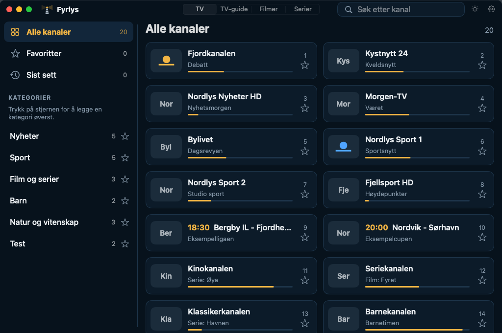
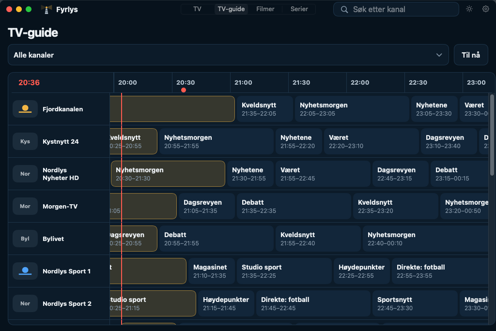
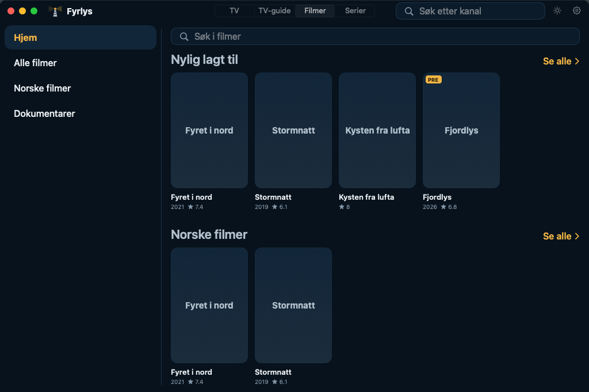
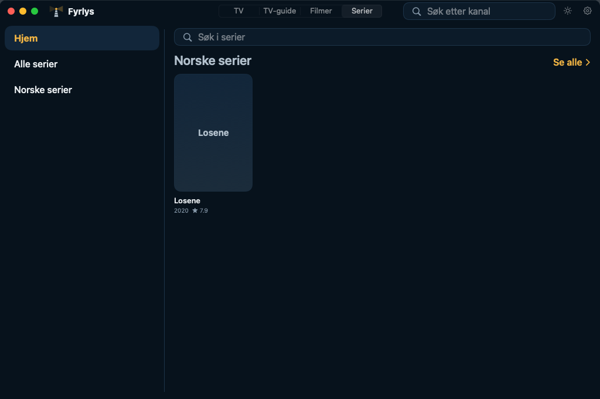
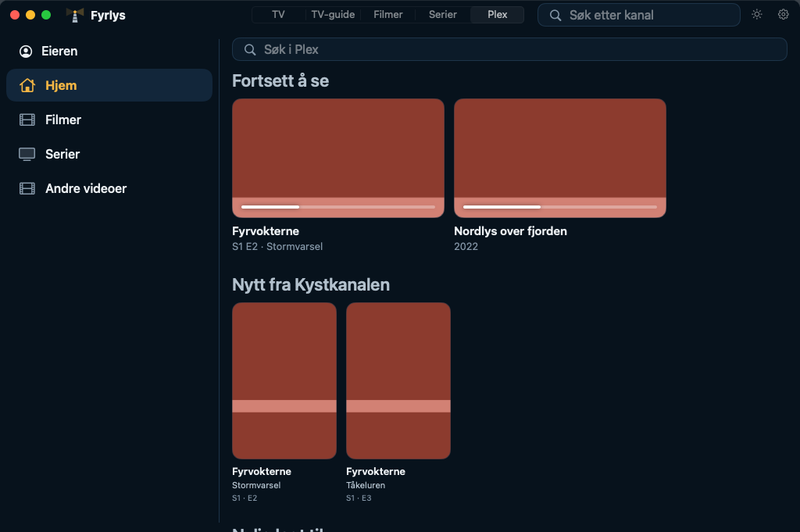
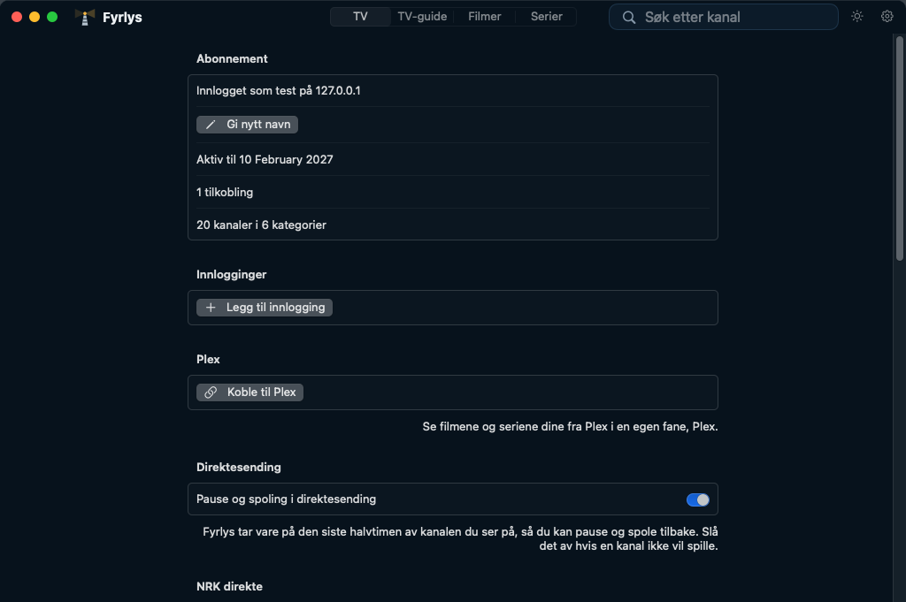
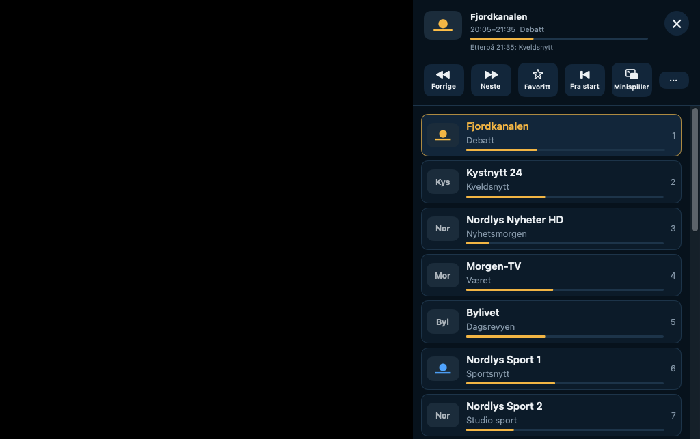
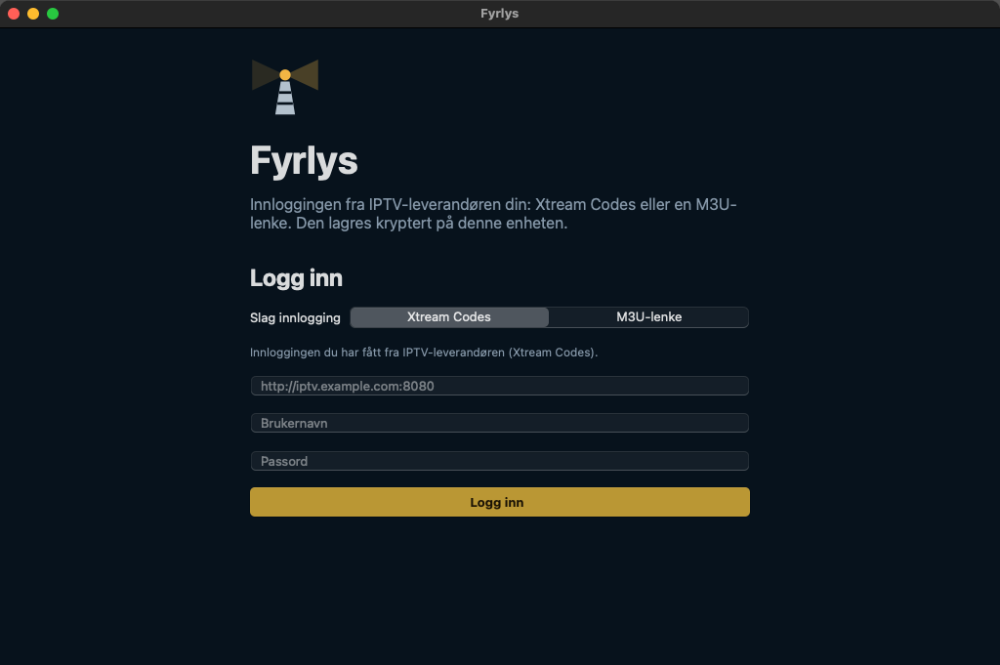

# Skjermbilder fra Mac

Fra Mac-appen i bygg 75 (00b68cf), mot den falske leverandøren i
`tools/fake_xtream.py` (oppdiktede kanaler). Videobildet er ikke med. Lages på nytt av hvert bygg.

## 01-mac-tv

## 02-mac-guide

## 03-mac-movies

## 04-mac-series

## 05-mac-plex

## 06-mac-settings

## 07-mac-player

## 08-mac-login

